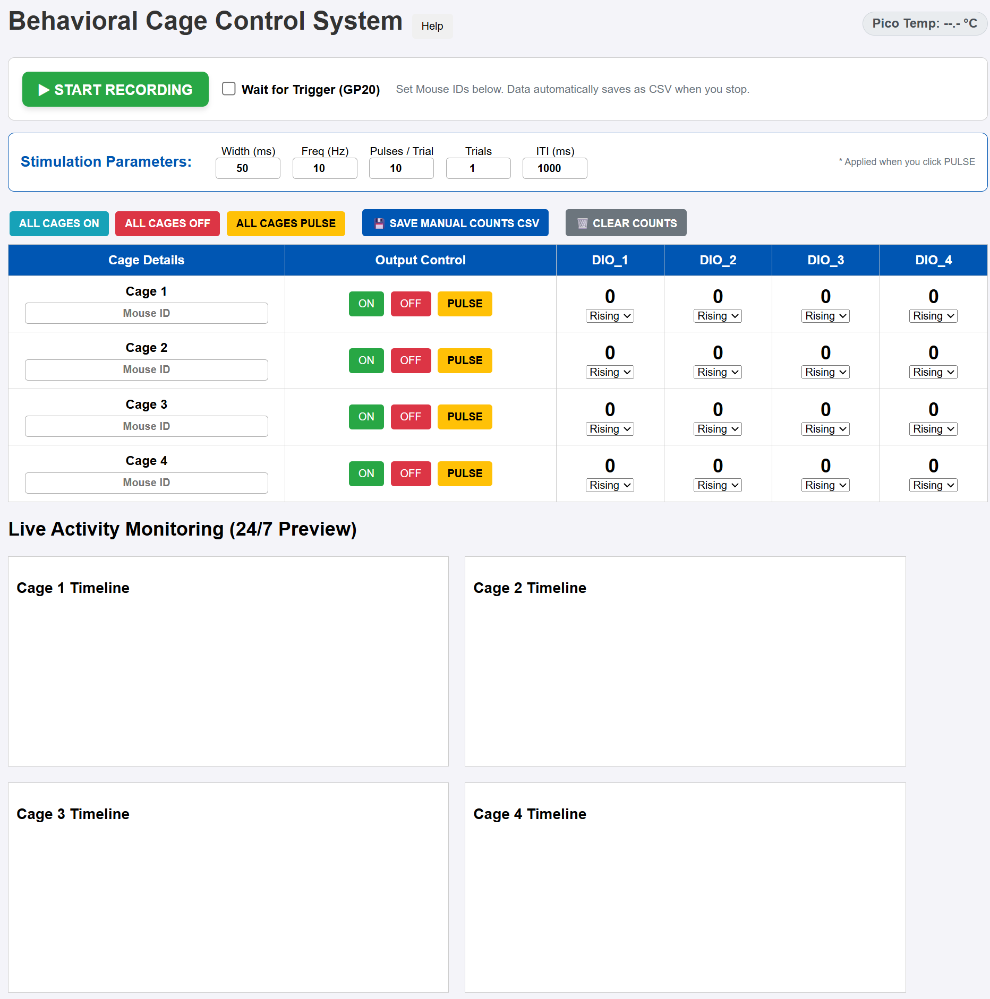

# Behavioral Cage Control System

A wireless, four-cage platform for delivering programmable stimulation and logging digital behavioral events in real time. It runs entirely on a **Raspberry Pi Pico W** using MicroPython, which hosts its own Wi-Fi access point and serves a browser-based dashboard — no software installation required on the client machine.

> 📄 **Project page:** [addy9908.github.io](https://addy9908.github.io/PicoW_BehavioralCageControlSystem.html)



---

## Features

- **4 independent cages**, each with 1 output channel and 4 digital inputs (16 DIO total)
- **Programmable stimulation** — configurable pulse width, frequency, pulses per trial, trial count, and inter-trial interval (ITI)
- **Live event monitoring** — a scrolling per-cage timeline plotting the output and all four inputs against the Pico's internal clock
- **Edge-based counting** — count events on rising or falling edges, selectable live per input
- **Recording with CSV export** — assign Mouse IDs, record, and auto-download timestamped per-cage CSV files on stop
- **External trigger sync** — arm recording to start on a 3.3V rising edge (GP20) for synchronization with external equipment
- **Boot safety switch** — ground GP22 at boot to abort the app and drop to the REPL for editing

---

## Repository Contents

| File | Description |
|------|-------------|
| `main.py` | Boot launcher with a GP22 safety switch; launches `app.py` unless aborted |
| `app.py` | Main application — Wi-Fi AP, async web server, hardware control, and event logic |
| `index.html` | Browser dashboard (served by the Pico) |
| `screenshot.png` | Screenshot of the dashboard *(add your own)* |

---

## Hardware Requirements

- Raspberry Pi Pico W
- Micro-USB cable
- Wiring to your cages (outputs + digital inputs)
- *(Optional)* A momentary switch or jumper for GP22 (boot safety)
- *(Optional)* An external signal source on GP20 (trigger sync)

### GPIO Pin Mapping

| Cage | Output | Inputs (DIO_1–4) |
|------|--------|------------------|
| Cage 1 | GP4 | GP0, GP1, GP2, GP3 |
| Cage 2 | GP9 | GP5, GP6, GP7, GP8 |
| Cage 3 | GP14 | GP10, GP11, GP12, GP13 |
| Cage 4 | GP19 | GP15, GP16, GP17, GP18 |

**Sync & safety pins**

| Pin | Function |
|-----|----------|
| GP20 | External trigger input (3.3V rising edge) |
| GP22 | Boot safety switch (ground to abort boot → REPL) |

> ⚠️ Inputs are configured with internal pull-downs and expect 3.3V logic. Do **not** apply 5V directly to any GPIO pin.

### Wiring

Each cage uses one output pin and four input pins, all referenced to a common ground.

**Outputs** — Each output pin (GP4, GP9, GP14, GP19) drives HIGH (3.3V) when ON or pulsing, and LOW (0V) when OFF. The Pico's GPIO can only source a few milliamps, so for anything beyond a low-current indicator LED (with a series resistor), drive your load through a transistor, MOSFET, or opto-isolated relay/driver board powered from its own supply. Never connect a motor, solenoid, or high-current device directly to a GPIO pin.

**Inputs** — Each input pin has an internal pull-down enabled, so it idles LOW and registers an event when pulled HIGH to 3.3V. Wire each sensor/signal so that an "active" state delivers a clean 3.3V edge. If your sensor outputs 5V, use a voltage divider or level shifter to drop it to 3.3V first.

**Grounds** — Tie the grounds of all sensors, drivers, and external equipment to the Pico's GND. Shared ground is required for the logic levels to be read correctly.

**Trigger (GP20)** — Connect your external trigger source to GP20. It has a pull-down and fires on a 3.3V rising edge. Share grounds between the trigger source and the Pico.

**Safety switch (GP22)** — GP22 is pulled HIGH internally. Wire a momentary pushbutton or jumper between GP22 and GND. Closing it at boot aborts the app and drops to the REPL.

| Connection | Pico pin | Notes |
|-----------|----------|-------|
| Cage output → driver/LED | GP4 / GP9 / GP14 / GP19 | Use a transistor/relay for real loads |
| Sensor signal → input | See pin map above | 3.3V HIGH = active; internal pull-down |
| External trigger → GP20 | GP20 | 3.3V rising edge |
| Safety switch → GP22 ↔ GND | GP22 | Ground to abort boot |
| All grounds → GND | GND | Common ground required |

---

## Build & Setup

### 1. Flash MicroPython onto the Pico W

1. Download the latest MicroPython UF2 firmware for the **Pico W** from [micropython.org/download/RPI_PICO_W](https://micropython.org/download/RPI_PICO_W/).
2. Hold the **BOOTSEL** button on the Pico W while plugging it into USB. It mounts as a drive named `RPI-RP2`.
3. Drag the `.uf2` file onto that drive. The board reboots automatically with MicroPython installed.

### 2. Install Thonny (editor / uploader)

1. Install [Thonny](https://thonny.org/).
2. Open Thonny → bottom-right corner → select **MicroPython (Raspberry Pi Pico)** as the interpreter.

### 3. Upload the project files

Copy all three files to the **root** of the Pico W's filesystem (same directory level):

- `main.py`
- `app.py`
- `index.html`

In Thonny, open each file and use **File → Save as… → Raspberry Pi Pico**, keeping the same filenames.

### 4. (Optional) Change the Wi-Fi credentials

Before deploying, edit the access point settings near the top of `app.py`:

```python
WIFI_SSID = 'Pico-Behavior-Lab'
WIFI_PASS = 'science123'
```

> 🔒 Change the default password before using this anywhere others can reach it. Treat the SSID/password as lab credentials — avoid committing real ones to a public repo.

### 5. Run it

Reset or power-cycle the Pico. `main.py` runs on boot:

- **No jumper on GP22** → launches the behavior app and starts the Wi-Fi access point.
- **GP22 grounded** → boot aborts and drops to the REPL (use this to edit files in Thonny).

On successful boot, the Pico prints its IP address (it acts as the AP, typically `192.168.4.1`).

---

## Usage

1. **Connect** your computer or phone to the Wi-Fi network (`Pico-Behavior-Lab` by default).
2. **Open a browser** and navigate to the Pico's IP address (shown in the Thonny console on boot).
3. **Enter Mouse IDs** for the cages you're using (at least one is required to start recording).
4. **Set stimulation parameters** — width, frequency, pulses, trials, ITI — then use the **ON / OFF / PULSE** buttons per cage or the **ALL CAGES** controls.
5. **Select edge type** (rising/falling) per input as needed.
6. **Record:**
   - Click **START RECORDING** to begin immediately, or
   - Check **Wait for Trigger (GP20)** to arm the system and start on an external signal.
7. **Stop** recording — the browser automatically downloads one CSV per active cage.

### Data Output

**Per-cage event CSV** (auto-saved on stop) — filename `Cage{n}_{MouseID}_{timestamp}_Events.csv`:

```
computerTime(ms),TrialTime(ms),Output,DIO_1,DIO_2,DIO_3,DIO_4
```

**Manual counts CSV** (via the dashboard button) — filename `Manual_Counts_{timestamp}.csv`:

```
Cage,MouseID,DIO_1,DIO_2,DIO_3,DIO_4
```

---

## How It Works

- `app.py` brings up the Pico W as a **Wi-Fi access point** and runs an asynchronous web server (`uasyncio`) on port 80.
- GPIO inputs use **hardware interrupts** to catch edges and update counts and a shared event buffer.
- The dashboard polls `/api/data` every 100 ms for counts, states, temperature, and new events; stimulation and configuration go through `/api/control`, `/api/edge`, `/api/record`, and `/api/clear`.
- The live plot uses the Pico's absolute system clock to slide the timeline continuously, while CSV logging is gated to only events after the recording start time.

---

## Tech Stack

Raspberry Pi Pico W · MicroPython · uasyncio · Wi-Fi access point · HTML / CSS / JavaScript · HTML5 Canvas

---

## Troubleshooting

**The Wi-Fi network doesn't appear**
- Confirm you flashed the **Pico W** firmware, not the plain Pico build — only the W has Wi-Fi.
- Make sure GP22 isn't grounded; if it is, `main.py` aborts to the REPL and never starts the AP.
- Check the Thonny console for the "AP Mode Active" line and the printed IP. If it's not there, re-run or power-cycle the board.

**Connected to the Wi-Fi but the dashboard won't load**
- Browse to the exact IP printed on boot (the AP default is typically `192.168.4.1`), not a hostname.
- Confirm `index.html` is in the Pico's root filesystem alongside `app.py` — the server reads it from disk when you load `/`.
- Try a different browser or disable any VPN/proxy that might reroute local addresses.

**"Please enter a Mouse ID" when starting a recording**
- At least one cage must have a Mouse ID filled in before recording can start. Enter an ID and try again.

**Inputs never count / counts don't change**
- Verify the signal actually reaches 3.3V and shares a common ground with the Pico.
- Check the edge setting (rising vs. falling) matches your signal's active transition.
- Confirm you've wired to the correct GP pins for that cage (see the pin map).

**Outputs do nothing / device won't switch**
- GPIO pins can't drive high-current loads directly — use a transistor, MOSFET, or relay driver with its own power supply.
- Confirm the load's ground is tied to the Pico's GND.

**Armed for an external trigger but recording never starts**
- The trigger must be a rising edge to 3.3V on GP20, with a shared ground.
- The dashboard flips from "Waiting for Trigger" to "Recording" only after the Pico reports the trigger fired; watch for the console message.

**Need to edit files but the app keeps taking over**
- Ground GP22 and reset. The board drops to the REPL so you can edit and re-upload in Thonny without the app running.

**CSV files didn't download on stop**
- A cage only exports if it has both a Mouse ID and at least one logged event. Cages with no activity are skipped.
- Check that your browser isn't blocking automatic downloads from the page.

---

## MIT License
